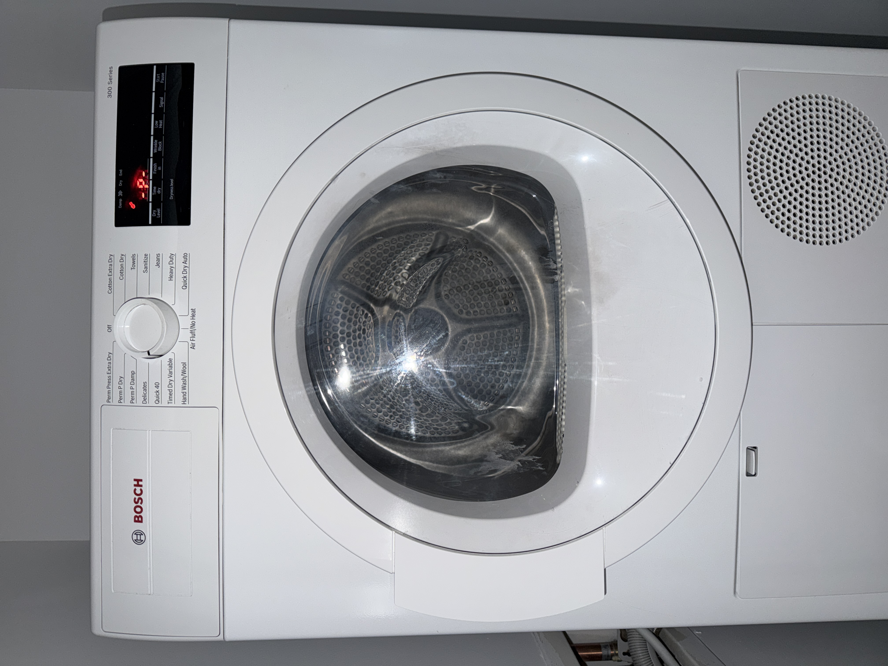

# One More Quick 40: Modeling My Home Dryer

**Name: Qingyu Liu**

## Appliance inspiration

My inspiration is the Bosch 300 Series dryer in my home. My usual routine is to load clothes, close the door, select Quick 40, and press Start. If the clothes are still damp, I run Quick 40 again. For items such as wool, I use No Heat. If I open the door during a cycle, closing it does not restart the dryer: I must press Start again.

## Design: what I wanted to model

I focused on the logic behind the controls: choosing a mode, starting and pausing, opening the door, and keeping track of remaining time. The selector includes all 16 positions in my photograph, including Off. Opening the door pauses the cycle. Removing clothes preserves the remaining minutes; closing the door still requires Start to continue.

I also wanted to improve my routine. After the first Quick 40 cycle, the model checks simulated moisture. If the clothes are still damp, it automatically runs one additional Quick 40 cycle. This is my proposed feature, not a claim about the actual machine. It adds at most one automatic cycle per manually started run.

## Variables and states

The program uses cycle to store the selected mode and state to store off, ready, running, paused, or finished. The Boolean variables doorOpen and hasClothes describe the door and load. minutesLeft stores the remaining simulated minutes. moistureLevel stores an invented moisture score from 0 to 100, and autoRepeatCount records whether the extra cycle has already been used.

These variables describe different parts of the appliance. For example, the dryer can be paused with the door open or paused with the door closed. Closing the door changes doorOpen, but it does not change state to running. This separation is what makes the manual restart rule possible.

## Events, transitions, and control flow

I was curious about how turning a dial tells the machine which mode to run. In this browser model, changing the dropdown triggers a change event. Its event handler stores the selection in cycle and prepares the timer. Clicking Start triggers a click event. The handler uses if and else if to check whether a cycle is selected, whether the door is open, and whether the machine is already running. It then starts, pauses, or resumes the cycle.

The timer callback runs every second, but only changes the countdown when state is running. When the timer reaches zero, another if statement checks four conditions: the cycle is Quick 40, clothes are present, the moisture score is above 10, and no automatic repeat has been used. If all four are true, the timer resets to 40 and the extra cycle begins. Otherwise, the dryer enters finished. The repeat counter prevents an endless loop.

The render function updates the visible state, time, heat label, door appearance, and moisture score after the variables change. This connects the hidden program state to feedback that the user can see.

## Testing, feedback, and revision

I ran the first version and requested two corrections. First, the selector needed to include every mode shown in my photograph. Second, removing clothes should not reset the timer to 40. It should preserve whatever time remains, then require Start to continue after the door closes. Codex changed both behaviors, and I accepted those revisions.

Codex also ran automated logic checks for the final moisture feature. A starting score of 70 falls to 30 after one Quick 40 cycle, so one extra cycle runs. A starting score of 50 reaches the dry threshold of 10 after one cycle, so no repeat occurs. A score of 100 remains at 20 after two cycles, but the model stops because the one-repeat limit has been reached. Other checks covered No Heat, an empty drum, all selector positions, and pausing during the extra cycle. These automated checks were performed by Codex; they are separate from my own feedback on the earlier version.

## AI support and reflection

I supplied the photograph and explained how I actually use the dryer. Codex turned those observations into HTML, CSS, JavaScript variables, event handlers, and conditional statements. My questions focused on how the physical choice of a mode becomes a program instruction, and how a moisture check could replace my habit of manually starting Quick 40 again.

The first version did not capture every detail of my experience. It omitted most modes and reset the timer after removing clothes. My role was to compare the model with my appliance and explain the mismatch. That interaction shows why working code still needs to be tested against the behavior I intended. AI helped with implementation, while my observations supplied the rules and corrections.

The improvement I requested also changed the problem: the model needed information about dampness, not just time. The browser cannot measure real clothes, so it uses a simulated score. A useful next step for my learning is to trace one button press through the event handler, the variable changes, and the screen update, then predict what should happen before testing it.

## Modeling assumptions

One real second represents one simulated minute. All active cycles use 40 minutes; durations other than Quick 40 are placeholders. All modes except Air Fluff / No Heat use simplified heat-on behavior. Heated cycles reduce the invented moisture score by one point per simulated minute, while No Heat leaves it unchanged. A score of 10 or less means dry in this model only. Real temperature, fabric behavior, and sensor measurements are not reproduced. Loading clothes assigns the score selected on the slider without resetting remaining time; removing clothes clears that score. Changing modes resets the timer and repeat counter.

## Project and AI transcript links

GitHub repository: https://github.com/ql2609-10/dryer-doodle

GitHub profile: https://github.com/ql2609-10

Codex transcript: https://chatgpt.com/s/cx_6af35f8f16288191abd32108556d7f95
